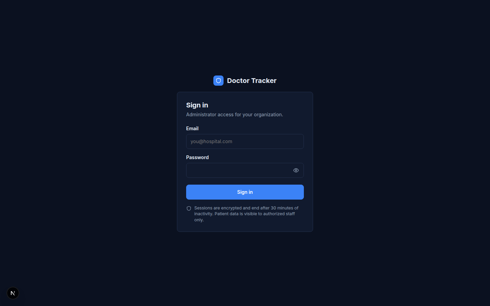
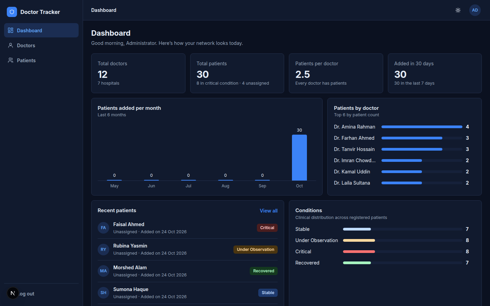
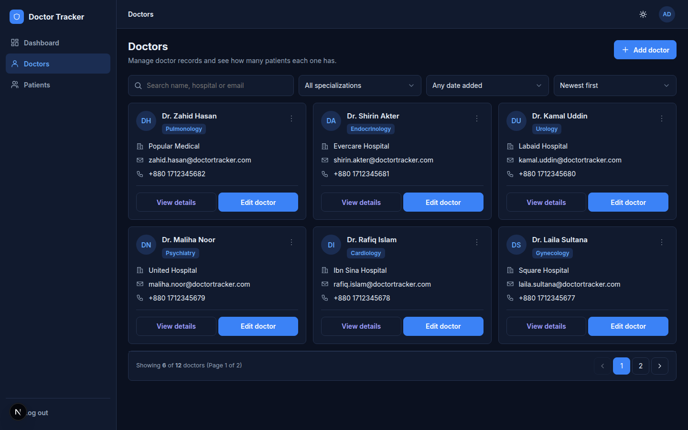
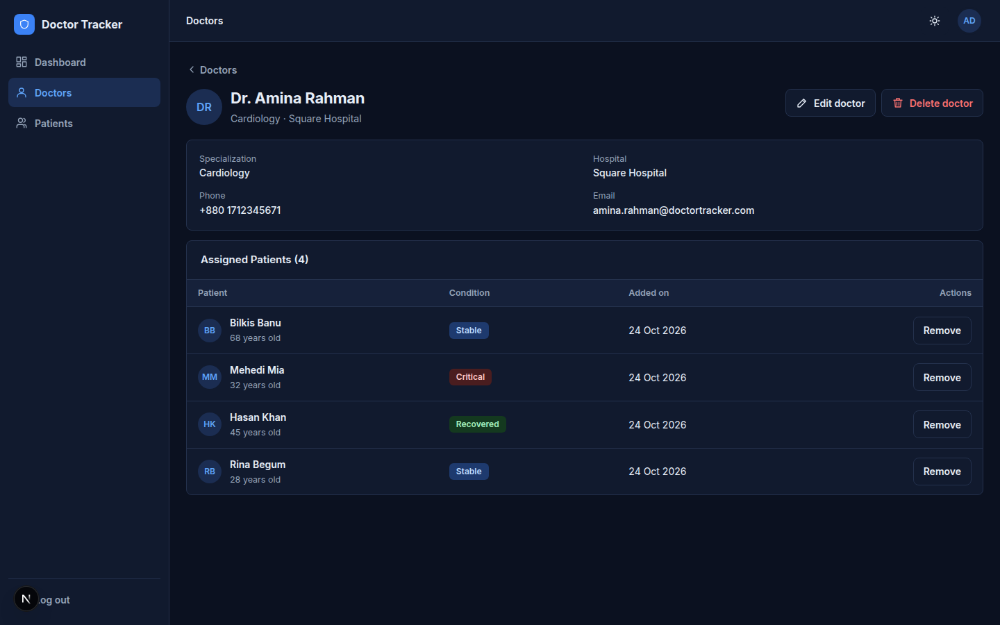
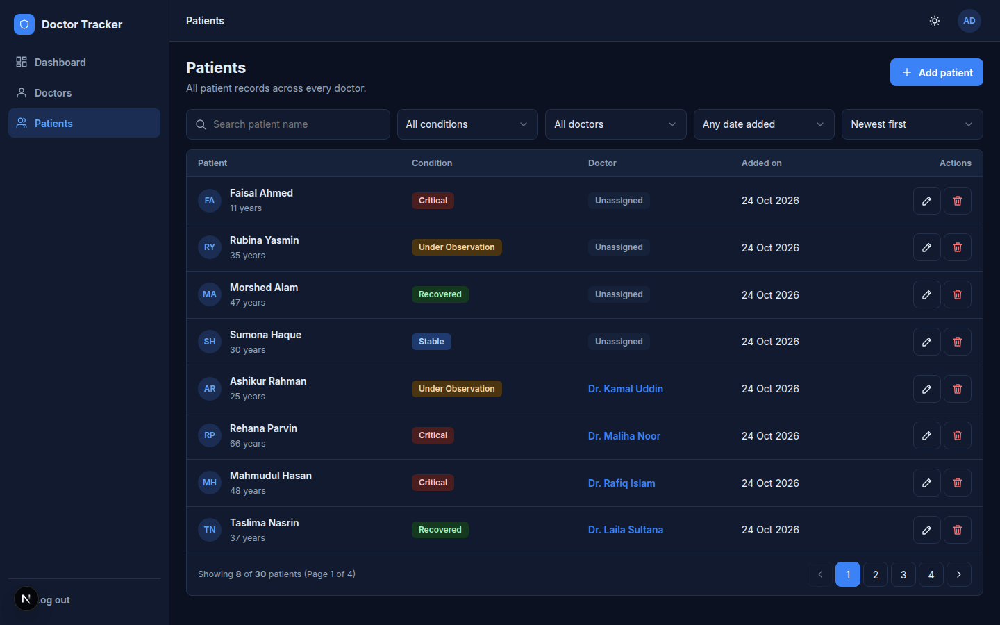
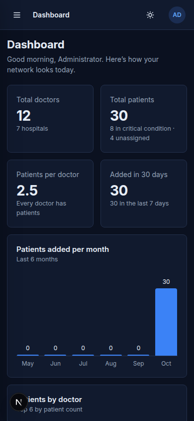
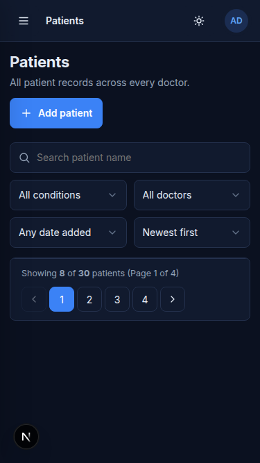
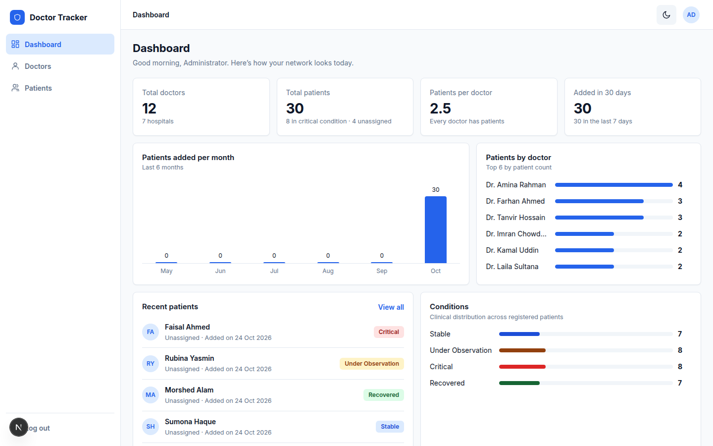

# Doctor Tracker — Healthcare Network Operations Management

A full-stack medical administration application built with a **Next.js (App Router, TypeScript)** frontend and an **Express + Node.js (TypeScript, MongoDB/Mongoose)** backend. Doctor Tracker provides healthcare administrators with real-time visibility into doctor caseloads, patient clinical conditions, and admission trends across clinic networks.

---

## 1. Description

Doctor Tracker is designed for clinic managers, hospital operations directors, and medical staff administrators who require oversight over multi-facility doctor assignments and patient records.

### Core Capabilities
- **Executive Analytics Dashboard:** High-level summary metrics (total doctors, active hospitals, total patients, critical cases, average caseload per doctor, idle doctors, unassigned patients, 7-day and 30-day admission volumes), 6-month monthly admissions trend chart, top doctor caseload progress meters, recent patient activity feed, and clinical condition distribution breakdown.
- **Doctors Management Directory:** Paginated doctor directory supporting live multi-field search (name, specialization, hospital, email), filters (specialization, date range), bounded sorting, responsive desktop data table with mobile cards, one-click email copy with clipboard feedback, modal for adding/editing records, doctor profile view with assigned patient rosters, and safe deletion that unassigns patients without data loss.
- **Patients Management Directory:** Paginated patient directory with search by name, filters by clinical condition (`Stable`, `Under Observation`, `Critical`, `Recovered`), doctor assignment filter (including unassigned patients), admission date filtering, modal for adding/editing patients with live doctor assignment/reassignment, and permanent patient record deletion.
- **Authentication & Security:** Administrator authentication utilizing secure HTTP-only cookies (`token`), route guarding preventing protected content flash, exact-origin CORS with credentials, Helmet security headers, Zod input validation, and synchronized dark/light theme persistence.

---

## 2. Setup Guide

### Prerequisites
- **Node.js:** v18.0.0 or later (v20+ recommended)
- **npm:** v9.0.0 or later
- **MongoDB:** A running MongoDB instance (local community instance at `mongodb://127.0.0.1:27017` or a MongoDB Atlas cluster)

---

### Step 1: Repository Installation
Clone the repository and install dependencies in both the `server/` and `client/` workspaces:

```bash
# 1. Install backend dependencies
cd server
npm install

# 2. Install frontend dependencies
cd ../client
npm install
cd ..
```

---

### Step 2: Environment Configuration
Create environment files from the provided `.env.example` templates in both folders:

#### Backend Environment (`server/.env`)
Copy `server/.env.example` to `server/.env`:
```bash
cp server/.env.example server/.env
```
Populate the configuration values using your target database and secret:
```ini
# Server Runtime Configuration
PORT=5000
NODE_ENV=development

# MongoDB Connection String (Local instance or MongoDB Atlas cluster)
MONGODB_URI=mongodb://127.0.0.1:27017/doctor_tracker

# JWT Authentication (Use a secure, high-entropy secret in production)
JWT_SECRET=your_high_entropy_jwt_secret_key_minimum_32_characters
JWT_EXPIRES_IN=7d

# Allowed Client Origin for CORS
CLIENT_URL=http://localhost:3000

# Development Seed Admin Account (Used by npm run seed)
SEED_ADMIN_EMAIL=admin@doctortracker.com
SEED_ADMIN_PASSWORD=password123
```

#### Frontend Environment (`client/.env.local`)
Copy `client/.env.example` to `client/.env.local`:
```bash
cp client/.env.example client/.env.local
```
Configure the backend API base URL:
```ini
# Backend REST API Base URL
NEXT_PUBLIC_API_URL=http://localhost:5000/api/v1
```

> [!CAUTION]
> Never commit `.env` or `.env.local` files to version control. Both are excluded via the root `.gitignore`.

---

### Step 3: Database Seeding (Fictional Development Data)
Ensure your target MongoDB instance is reachable, then run the idempotent seeder from the `server/` directory:
```bash
cd server
npm run seed
```
The seeder creates:
- **1 Admin User:** `admin@doctortracker.com` (hashed password with bcryptjs)
- **12 Realistic Doctors:** Across Cardiology, Neurology, Pediatrics, Diagnostics, Oncology, Orthopedics, etc.
- **30 Fictional Patients:** Distributed across clinical conditions (`Stable`, `Observation`, `Critical`, `Recovered`), with realistic doctor assignments and unassigned patients.

*Note: The seeder uses stable emails and identifiers, making it completely safe to rerun without creating duplicate records or dropping collections.*

---

### Step 4: Running the Application Locally

#### Terminal 1 — Backend API Server
```bash
cd server
npm run dev
# Starts backend server on http://localhost:5000 (with tsx watch)
```

#### Terminal 2 — Frontend Next.js Client
```bash
cd client
npm run dev
# Starts Next.js development server on http://localhost:3000
```

Open your browser and navigate to **`http://localhost:3000`**. You will be redirected to `/login`. Sign in using the development administrator credentials:
- **Email:** `admin@doctortracker.com`
- **Password:** `password123`

---

### Step 5: Running Automated Tests

#### Frontend Tests (103 tests)
```bash
cd client
npm test
# Runs Auth, Dashboard, Doctors, and Patients unit/integration test suites
```

#### Frontend Quality Checks
```bash
cd client
npm run typecheck   # TypeScript validation (tsc --noEmit)
npm run lint        # ESLint code quality checks
npm run build       # Next.js Turbopack production bundle build
```

#### Backend Tests (56 tests)
```bash
cd server
npm test
# Runs Auth, Doctors API, Patients API, and Dashboard aggregation test suites
```

#### Backend Quality Checks
```bash
cd server
npm run typecheck   # TypeScript typechecking
npm run build       # Production TypeScript compilation to dist/
```

---

### Troubleshooting
- **MongoDB `ECONNREFUSED` or Timeout:** Verify MongoDB service is running locally (`systemctl status mongod` or `mongod`) or confirm your MongoDB Atlas IP Access List allows connections from your current IP address.
- **CORS / Cookie Rejection:** Ensure `CLIENT_URL` in `server/.env` matches `http://localhost:3000` exactly. Cookies require credentials mode (`credentials: 'include'`).
- **Port Conflict:** If port 5000 or 3000 is occupied, update `PORT` in `server/.env` and `NEXT_PUBLIC_API_URL` in `client/.env.local`.

---

## 3. System Architecture

```
                    +------------------------------------+
                    |        Browser / Next.js Client    |
                    |         (http://localhost:3000)    |
                    +-----------------+------------------+
                                      |
                      HTTP Requests with credentials
                      (HTTP-Only Cookie: "token")
                                      |
                                      v
                    +------------------------------------+
                    |       Express REST API Server      |
                    |         (http://localhost:5000)    |
                    +-----------------+------------------+
                                      |
           +--------------------------+--------------------------+
           |                          |                          |
           v                          v                          v
+---------------------+    +---------------------+    +---------------------+
|   Helmet Security   |    |    CORS Validator   |    |    Cookie Parser    |
|   & Headers         |    | (Exact Client Origin|    |  & Auth Middleware  |
+---------------------+    +---------------------+    +---------------------+
                                      |
                                      v
                    +------------------------------------+
                    |       Zod Request Validation       |
                    +-----------------+------------------+
                                      |
                                      v
                    +------------------------------------+
                    |         Route Controllers          |
                    |   Auth | Dashboard | Doc | Pat     |
                    +-----------------+------------------+
                                      |
                                Mongoose ORM
                                      |
                                      v
                    +------------------------------------+
                    |              MongoDB               |
                    |     Users | Doctors | Patients     |
                    +------------------------------------+
```

### Request Flow & Security Model
1. **Transport & Credentials:** All API requests from the frontend client specify `credentials: 'include'`. The authentication JWT is stored in an `HttpOnly`, `SameSite=lax` cookie named `token`, which the browser automatically attaches to requests. No JWT is ever stored in `localStorage` or `sessionStorage`.
2. **CORS & Middleware Pipeline:** Incoming requests are inspected by Express CORS with `origin: CLIENT_URL` and `credentials: true`. Protected routes pass through `requireAuth`, which verifies the JWT signature and attaches the authenticated user payload to `req.user`.
3. **Validation & ORM:** Route inputs are strictly validated against Zod schemas before reaching controller logic. Centralized error handling normalizes database validation and duplicate key errors into structured JSON responses.

### Key API Endpoints

| Category | Method | Endpoint | Description | Auth Required |
| :--- | :--- | :--- | :--- | :--- |
| **System** | `GET` | `/health` | Server health check | No |
| **Auth** | `POST` | `/api/v1/auth/login` | Validates credentials and sets HTTP-only `token` cookie | No |
| **Auth** | `POST` | `/api/v1/auth/logout` | Emits expired cookie to terminate session | Yes |
| **Auth** | `GET` | `/api/v1/auth/me` | Returns current administrator profile | Yes |
| **Dashboard** | `GET` | `/api/v1/dashboard/stats` | Multi-faceted aggregations for all dashboard KPIs | Yes |
| **Doctors** | `GET` | `/api/v1/doctors` | Paginated listing with search, filters, and sorting | Yes |
| **Doctors** | `GET` | `/api/v1/doctors/:id` | Doctor profile with populated assigned patients | Yes |
| **Doctors** | `POST` | `/api/v1/doctors` | Create doctor (enforces unique email) | Yes |
| **Doctors** | `PATCH` | `/api/v1/doctors/:id` | Update doctor record | Yes |
| **Doctors** | `DELETE` | `/api/v1/doctors/:id` | Deletes doctor and safely unassigns their patients | Yes |
| **Patients** | `GET` | `/api/v1/patients` | Paginated listing with condition & doctor filters | Yes |
| **Patients** | `GET` | `/api/v1/patients/:id` | Patient details with populated doctor info | Yes |
| **Patients** | `POST` | `/api/v1/patients` | Register patient (optional doctor assignment) | Yes |
| **Patients** | `PATCH` | `/api/v1/patients/:id` | Update patient, reassign, or explicitly unassign | Yes |
| **Patients** | `DELETE` | `/api/v1/patients/:id` | Permanently deletes single patient record | Yes |

---

## 4. Technical Decisions

### Decision 1: HTTP-Only Cookie Session Architecture vs. LocalStorage JWTs
- **Alternatives Considered:** Storing the JWT access token in browser `localStorage` or `sessionStorage` and transmitting it via the `Authorization: Bearer <token>` header.
- **Rationale:** Storing sensitive authentication tokens in browser web storage exposes them to exfiltration via Cross-Site Scripting (XSS) attacks. By contrast, issuing the token in an `HttpOnly`, `SameSite: 'lax'`, `path: '/'` cookie prevents client-side JavaScript access while ensuring the browser automatically transmits the credential on every API request.
- **Trade-offs & Implementation Consequences:**
  - The client cannot inspect token claims or expiration timestamps directly in JavaScript. To resolve this, the client checks the session via `GET /api/v1/auth/me` on initial mount.
  - Cross-origin requests between `localhost:3000` and `localhost:5000` require explicit CORS configuration (`origin: CLIENT_URL`, `credentials: true`) and fetch `credentials: 'include'`.
  - **Stateless JWT Limitation:** Session termination on logout clears the cookie from the client browser. In a pure stateless JWT model, previously issued tokens remain cryptographically valid until expiration (`7d`) because server-side token blacklisting is not implemented. This is a deliberate design trade-off prioritizing backend horizontal scalability over stateful revocation tables.

### Decision 2: Patient Retention and Cascade-Unassignment on Doctor Deletion
- **Alternatives Considered:**
  1. *Cascading Deletion:* Automatically deleting all patients assigned to a doctor when that doctor record is deleted.
  2. *Restrict Deletion:* Rejecting doctor deletion with a `400 Bad Request` whenever a doctor still has assigned patients.
  3. *Cascade-Unassignment:* Deleting the doctor record while atomically setting `doctor: null` on all assigned patients.
- **Rationale:** In clinical operations, medical patient records represent legal health documentation and must never be destroyed simply because an attending physician departs the healthcare network or is removed from the directory. Restricting deletion creates operational bottlenecks when reorganizing clinics. Cascade-unassignment safely preserves patient history while accurately reflecting their unassigned status.
- **Implementation & UI Safeguards:**
  - The backend executes `Patient.updateMany({ doctor: doctor._id }, { $set: { doctor: null } })` prior to `Doctor.findByIdAndDelete(id)`.
  - The frontend deletion dialog explicitly informs administrators: *"Their assigned patients will remain in the system as unassigned. Patient medical records are safely preserved."*
  - This behavior is distinctly contrasted with the global Patients page's Delete action, which performs a permanent deletion (`DELETE /api/v1/patients/:id`) after warning the user: *"Their medical record will be completely removed from the system."*

---

## 5. Visual Evidence

The user interface strictly adheres to the visual language, color tokens, and responsive breakpoints established in `Doctor Tracker.html`. The following genuine screenshots were captured from the running application connected to live seeded database records across desktop and mobile viewports:

### 1. Authentication View

*Desktop (1440px) — Sign-in portal with validation, password visibility toggle, and secure session credentials.*

### 2. Operational Analytics Dashboard

*Desktop (1440px) — 4 KPI summary cards (12 doctors, 30 patients, caseload metrics), 6-month patient admissions bar chart, attending doctor caseload progress meters, and clinical condition breakdown.*

### 3. Doctors Management Directory

*Desktop (1440px) — Paginated roster table (6 doctors per page), avatar initials, multi-field search, specialization filters, copy-to-clipboard contact shortcuts, and contextual action menus.*

### 4. Doctor Detail & Assigned Patients Roster

*Desktop (1440px) — Clinical profile metadata (`.dl`), contact credentials, and dedicated assigned patients table with individual unassignment dialog safeguards.*

### 5. Patients Management Directory

*Desktop (1440px) — Global patient directory with pagination (8 patients per page), clinical condition badges (`Stable`, `Observation`, `Critical`, `Recovered`), attending doctor assignments, and permanent deletion controls.*

### 6. Mobile Responsiveness & Layout Adaptations
| Mobile Dashboard (390px) | Mobile Patients Cards (375px) |
| :---: | :---: |
|  |  |
| *Single-column KPI cards and responsive admissions chart* | *Stacked `.pcs` mobile cards with touch targets $\ge 44$px* |

### 7. Synchronized Dark Theme

*Desktop (1440px) — High-contrast clinical dark theme synchronized across application tabs.*

---

### Visual Evidence Verification Summary

| Viewport | Route / Component | Verified Artifact Path | Status |
| :--- | :--- | :--- | :--- |
| **Desktop (1440px)** | `/login` | [`docs/screenshots/01_login.png`](docs/screenshots/01_login.png) | Verified & Captured |
| **Desktop (1440px)** | `/dashboard` | [`docs/screenshots/02_dashboard_desktop.png`](docs/screenshots/02_dashboard_desktop.png) | Verified & Captured |
| **Desktop (1440px)** | `/doctors` | [`docs/screenshots/03_doctors_directory.png`](docs/screenshots/03_doctors_directory.png) | Verified & Captured |
| **Desktop (1440px)** | `/doctors/[id]` | [`docs/screenshots/04_doctor_detail.png`](docs/screenshots/04_doctor_detail.png) | Verified & Captured |
| **Desktop (1440px)** | `/patients` | [`docs/screenshots/05_patients_directory.png`](docs/screenshots/05_patients_directory.png) | Verified & Captured |
| **Mobile (390px)** | `/dashboard` | [`docs/screenshots/06_dashboard_mobile.png`](docs/screenshots/06_dashboard_mobile.png) | Verified & Captured |
| **Mobile (375px)** | `/patients` | [`docs/screenshots/07_patients_mobile.png`](docs/screenshots/07_patients_mobile.png) | Verified & Captured |
| **Theme (Dark)** | `/dashboard` | [`docs/screenshots/08_dashboard_dark.png`](docs/screenshots/08_dashboard_dark.png) | Verified & Captured |

